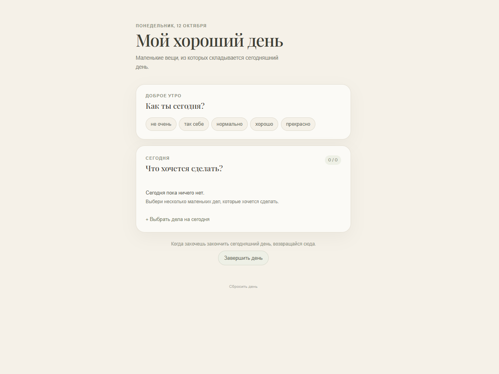
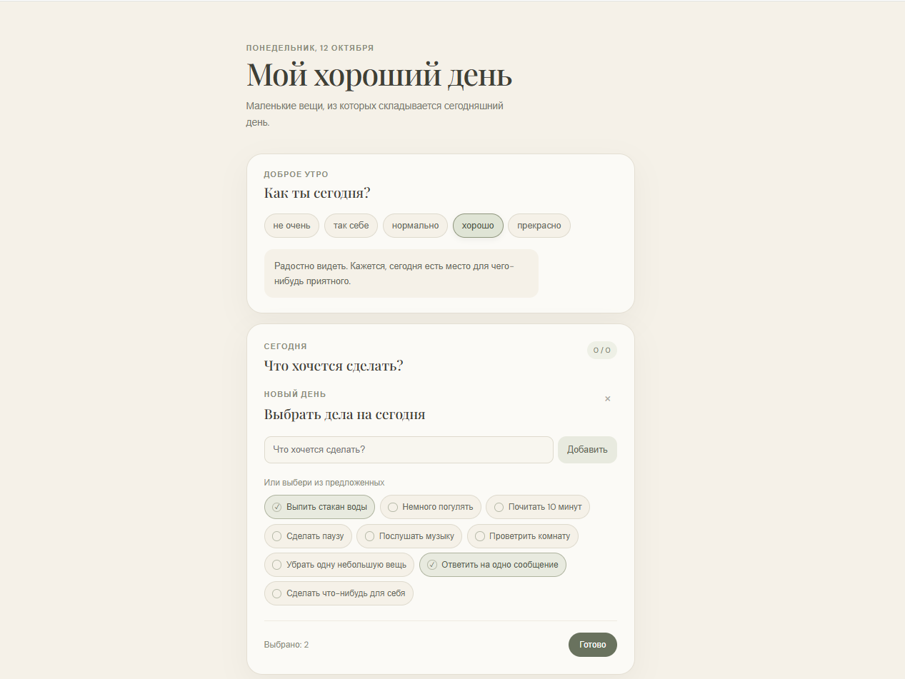
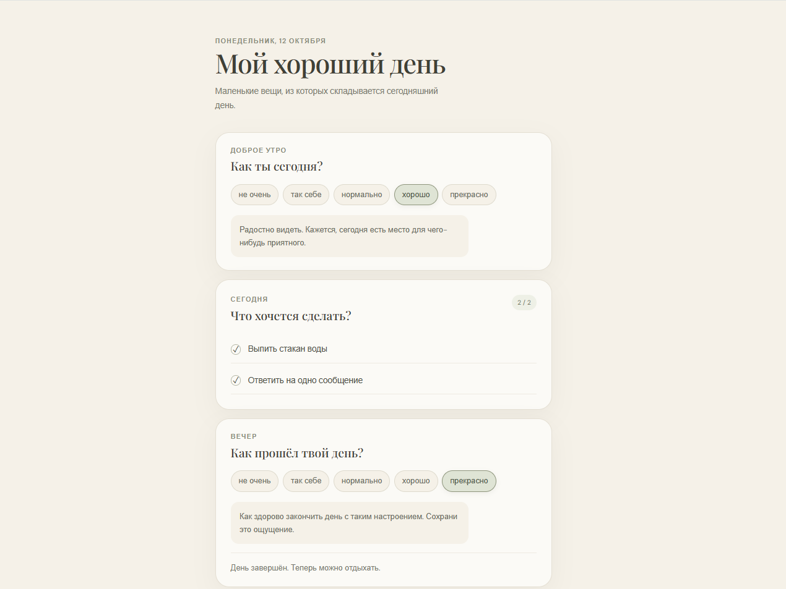

# Мой хороший день

Небольшое уютное веб-приложение для ежедневных ритуалов, заботы о себе и осознанного завершения дня.

**«Мой хороший день»** помогает прислушаться к своему настроению, выбрать несколько посильных дел и вечером подвести небольшой итог. Без гонки за продуктивностью — только маленькие шаги и немного внимания к себе.

## Идея проекта

Проект создан в рамках эксперимента по разработке веб-приложения с помощью AI за ограниченное время.

Цель эксперимента — за два часа с нуля (даже без идеи) с помощью AI спроектировать интерфейс и пользовательские сценарии, реализовать интерактивность, сохранить состояние приложения и продумать визуальную составляющую.

## Скриншоты

### Выбор утреннего настроения



### Выбор дел на сегодня



### Завершение дня



## Возможности

- **Утреннее настроение** — выбери своё состояние и получи поддерживающее сообщение.
- **План на день** — выбери дела из предложенного списка или добавь собственные.
- **Список задач** — отмечай выполненное, добавляй новые дела и удаляй ненужные.
- **Вечернее настроение** — заверши дневную часть и отметь своё настроение в конце дня.
- **Сохранение данных** — состояние приложения сохраняется в браузере и не теряется после перезагрузки страницы.

## Дизайн

Интерфейс выполнен в спокойной, уютной эстетике цифрового дневника: тёплый кремовый фон, приглушённые природные оттенки, мягкие карточки и типографика, которая помогает сосредоточиться на содержании.

## Технологии

- React — создание пользовательского интерфейса.
- TypeScript — типизация и более надёжная работа с данными.
- Vite — запуск сервера разработки и сборка проекта.
- CSS — стилизация и адаптивная вёрстка.
- `localStorage` — хранение состояния приложения в браузере.

## Запуск проекта

### Требования

- Node.js и npm.

### Установка

Клонируй репозиторий:

```bash
git clone <URL-РЕПОЗИТОРИЯ>
```

Перейди в папку проекта:

```bash
cd my-good-day
```

Установи зависимости:

```bash
npm install
```

Запусти приложение в режиме разработки:

```bash
npm start
```

Открой адрес, указанный в терминале. По умолчанию Vite обычно использует `http://localhost:5173`.

### Production-сборка

Чтобы проверить проект перед публикацией, выполни:

```bash
npm run build
```

Результат сборки появится в папке `dist/`.

## Хранение данных

Приложение работает без сервера, регистрации и базы данных. Состояние текущего дня хранится в `localStorage` браузера.

Данные привязаны к дате: при обнаружении нового дня приложение начинает новый ритуал.

---

*Создано для практики frontend-разработки и экспериментов с AI.*
